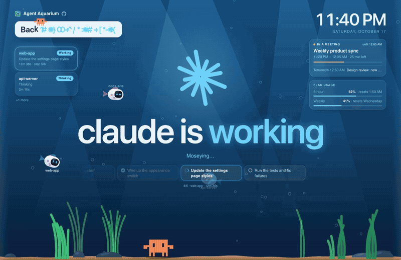

<div align="center">


# Agent Aquarium

**Your agents keep working. Don't tap the glass.**

A lock screen for your Mac that shows what your AI coding agents are doing while you're away.

[](https://github.com/danamsalem/agent-aquarium/releases/latest)


**[Download the free beta](https://github.com/danamsalem/agent-aquarium/releases/latest)** · [Website](https://agentaquarium.danamsalem.com) · [Roadmap](https://github.com/danamsalem/agent-aquarium/issues/9) · [Report a bug](https://github.com/danamsalem/agent-aquarium/issues/new/choose)

<br>



</div>

<br>

Your Mac stays locked, your agents keep going, and everyone walking past can see that you are in fact working rather than assuming you took the 7th coffee break today.

## Why

You start a long task in Claude Code, then you need to step away. Leave your Mac unlocked and anyone can walk up to it. Lock it and you can't see whether the agent finished, got stuck or is waiting for your approval.

Agent Aquarium runs as your screensaver, so your Mac stays locked and asks for your password as usual. The screen shows each agent's progress, so you know from across the room whether to come back now or finish your coffee.

## What you get

### On the lock screen

| | |
|---|---|
| **Live agent status** | Every Claude Code session, working, done or waiting for you. The current session's task list is a row of cards that slides along as the agent works. |
| **Needs-you alerts** | The screen glows when an agent is waiting for your approval, so you notice from across the room. |
| **Your away message** | "Back in 10." "In a meeting." Pick a preset or write your own, in any language, right-to-left included. A little crab plays with the letters. |
| **Your calendar** | The meeting you're in and what's next, from Google, Apple or Outlook calendars, so people know when you'll be back. |
| **Plan usage** | How much of your Claude plan's 5-hour and weekly limits you've used, and when they reset. |

### On your Mac

| | |
|---|---|
| **Menu bar fish** | A little fish shows at a glance whether your agents are working or need you. Click it to set your message, switch theme or start the screensaver. |
| **Keep your Mac awake** | Optional: your Mac won't fall asleep in the middle of a long run. The screen still turns off and locks as usual. |
| **Always-on display** | Show the scene full screen on a second monitor all the time. |
| **Battery estimate** | See what the lock screen costs your battery, per theme. |
| **Local and private** | Everything runs on your Mac. No account, no tracking, no servers of ours. |

## Themes

| Theme | |
|---|---|
| **Aquarium** | Every session is a little robot fish: busy ones swim around, one that needs you taps the glass, finished ones doze on the sand. |
| **Warm** | Warm tones, clean type and a glowing starburst. |
| **Retro pixel** | A CRT terminal with an 8-bit crab. |
| **Cosmic** | Deep space, with an astronaut crab on a jetpack. |

Try them all live on the [website](https://agentaquarium.danamsalem.com).

## Install

**You need:** a Mac with Apple silicon (M1 or later), macOS 13 or later, and [Claude Code](https://claude.com/claude-code).

1. Download the zip from the **[latest release](https://github.com/danamsalem/agent-aquarium/releases/latest)** and double-click it to unzip.
2. Drag **Agent Aquarium** into your **Applications** folder.
3. Open it. The beta isn't notarized by Apple yet, so macOS blocks it the first time (see below).
4. Click **Connect Claude Code** when asked. The app adds a hook to `~/.claude/settings.json` (a backup is saved first). Restart any Claude Code sessions that are already open.
5. Choose **Agent Aquarium** in **System Settings → Screen Saver** (under Other). To keep your Mac locked while it shows, set Lock Screen → "Require password after screen saver begins" to **Immediately**.

<details>
<summary><b>macOS says it can't verify "Agent Aquarium"</b></summary>

<br>

That's expected while the beta isn't notarized:

1. Click **Done** (not Move to Trash).
2. Open **System Settings → Privacy & Security**, scroll down to the message about "Agent Aquarium" and click **Open Anyway**, then enter your password.
3. Open Agent Aquarium again and click **Open**.

Or, in Terminal:

```bash
xattr -dr com.apple.quarantine "/Applications/Agent Aquarium.app"
```

</details>

**Updating?** Replace the app in Applications with the new one; your settings stay. Starring or watching this repo tells you about new versions.

## Tips

- **Start it any time:** set a Hot Corner to "Start Screen Saver" in System Settings → Desktop & Dock → Hot Corners.
- **Set your message on the way out:** click the fish in the menu bar and pick a preset.
- **Second monitor:** Agent Aquarium menu → **Always-On Display**. Press Esc to close it.
- **Plan usage** updates when you use `claude` in a terminal (not in the Claude desktop app). The app asks before turning it on, and your own status line keeps working exactly as before.

## FAQ

<details>
<summary><b>Does it unlock my Mac or weaken the lock screen?</b></summary>

<br>

No. It's a regular macOS screensaver: macOS still owns the lock and still asks for your password or Touch ID. Agent Aquarium only draws the picture behind it.
</details>

<details>
<summary><b>Does my code or chat go anywhere?</b></summary>

<br>

No. Claude Code's hooks write each session's state to a file on your Mac, and a small server that only accepts connections from your own Mac shows it on the lock screen. Nothing is sent to us, and we don't run any servers. The details are in the [privacy policy](https://agentaquarium.danamsalem.com/privacy).
</details>

<details>
<summary><b>Does it work with Codex, Cursor or other agents?</b></summary>

<br>

Claude Code only for now. Support for others is [on the roadmap](https://github.com/danamsalem/agent-aquarium/issues/6): give it a 👍 if you want it.
</details>

<details>
<summary><b>Why does Google say the app isn't verified?</b></summary>

<br>

Google is still reviewing the app. Until it's approved, signing in shows a "Google hasn't verified this app" screen: click Advanced → Go to Agent Aquarium. Calendar access is read-only. You can also skip Google and add an Apple or Outlook calendar link instead.
</details>

<details>
<summary><b>How do I uninstall it?</b></summary>

<br>

Agent Aquarium menu → **Uninstall Agent Aquarium…** removes the Claude Code hooks, the background service and the screensaver. Then drag the app to the Trash.
</details>

<details>
<summary><b>Is it free?</b></summary>

<br>

Yes, the beta is free.
</details>

## Roadmap

What's planned lives in the [roadmap issue](https://github.com/danamsalem/agent-aquarium/issues/9). Each idea is its own issue: give a 👍 to the ones you want most, it helps decide what comes next.

## Feedback

Found a bug or have an idea? [Open an issue](https://github.com/danamsalem/agent-aquarium/issues/new/choose). Like it? Star this repo and share it with a friend who codes with agents.

## Privacy

Everything stays on your Mac. Read the [privacy policy](https://agentaquarium.danamsalem.com/privacy).

---

<div align="center">

Made by [Dan Amsalem](https://github.com/danamsalem). Works with Claude Code. Not affiliated with Anthropic or Google.

</div>
