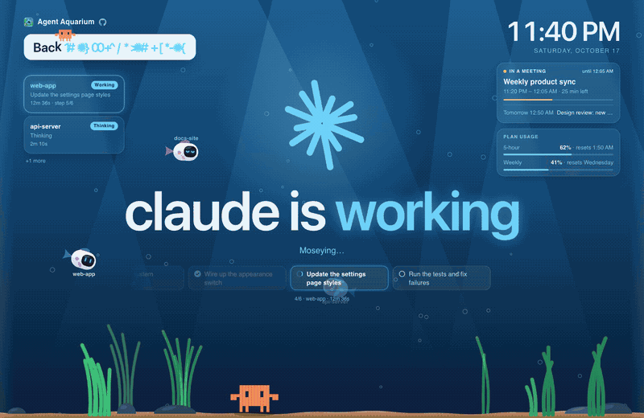

<div align="center">


# Agent Aquarium

**Your agents keep working. Don't tap the glass.**

Not another menu-bar monitor: the screen you leave behind.

A lock screen for your Mac that shows what your AI coding agents are doing while you're away. Free and open source (MIT).

[](https://github.com/danamsalem/agent-aquarium/releases/latest)


[](LICENSE)
[](https://github.com/danamsalem/agent-aquarium/stargazers)
[](https://x.com/dannamsalem)

**[Download for free](https://github.com/danamsalem/agent-aquarium/releases/latest)** · [Website](https://agentaquarium.danamsalem.com) · [Roadmap](https://github.com/danamsalem/agent-aquarium/issues/9) · [Build from source](#build-from-source) · [Contribute](CONTRIBUTING.md) · [Report a bug](https://github.com/danamsalem/agent-aquarium/issues/new/choose) · [X](https://x.com/dannamsalem)

<br>



<br><br>

**⭐ If Agent Aquarium makes stepping away easier, [star the repo](https://github.com/danamsalem/agent-aquarium/stargazers).** It helps other people who code with agents find it.

</div>

<br>

Your Mac stays locked, your agents keep going, and everyone walking past can see that you are in fact working rather than assuming you took the 7th coffee break today.

## Why

You start a long task in Claude Code, then you need to step away. Leave your Mac unlocked and anyone can walk up to it. Lock it and you can't see whether the agent finished, got stuck or is waiting for your approval.

Agent Aquarium runs as your screensaver, so your Mac stays locked and asks for your password as usual. The screen shows each agent's progress, so you know from across the room whether to come back now or finish your coffee.

## What you get

### On the lock screen

| | |
|---|---|
| **Live agent status** | Every Claude Code session, working, done or waiting for you. The current session's task list is a row of cards that slides along as the agent works. |
| **Needs-you alerts** | The screen glows when an agent is waiting for your approval, so you notice from across the room. |
| **Your away message** | "Back in 10." "In a meeting." Pick a preset or write your own, in any language, right-to-left included. A little crab plays with the letters. |
| **Your calendar** | The meeting you're in and what's next, from Google, Apple or Outlook calendars, so people know when you'll be back. |
| **Plan usage** | How much of your Claude plan's 5-hour and weekly limits you've used, and when they reset. |

### On your Mac

| | |
|---|---|
| **Menu bar fish** | A little fish shows at a glance whether your agents are working or need you. Click it to set your message, switch theme or start the screensaver. |
| **Keep your Mac awake** | Optional: your Mac won't fall asleep in the middle of a long run. The screen still turns off and locks as usual. |
| **Always-on display** | Show the scene full screen on a second monitor all the time. |
| **Saves battery** | On battery, the lock screen draws a little lighter, so it uses less of your charge. You can switch it off in settings. |
| **Local and private** | Everything runs on your Mac. No account, no tracking, no servers of ours. |

## Themes

| Theme | |
|---|---|
| **Aquarium** | Every session is a little robot fish: busy ones swim around, one that needs you taps the glass, finished ones doze on the sand. |
| **Warm** | Warm tones, clean type and a glowing starburst. |
| **Retro pixel** | A CRT terminal with an 8-bit crab. |
| **Cosmic** | Deep space, with an astronaut crab on a jetpack. |

Try them all live on the [website](https://agentaquarium.danamsalem.com).

## Install

**You need:** a Mac with Apple silicon (M1 or later), macOS 13 or later, and [Claude Code](https://claude.com/claude-code).

**With Homebrew:** `brew install --cask danamsalem/tap/agent-aquarium`, then continue from step 3. **From source:** see [Build from source](#build-from-source).

1. Download the zip from the **[latest release](https://github.com/danamsalem/agent-aquarium/releases/latest)** and double-click it to unzip.
2. Drag **Agent Aquarium** into your **Applications** folder.
3. Open it. The app isn't notarized by Apple yet, so macOS blocks it the first time (see below).
4. Click **Connect Claude Code** when asked. The app adds a hook to `~/.claude/settings.json` (a backup is saved first). Restart any Claude Code sessions that are already open.
5. Choose **Agent Aquarium** in **System Settings → Screen Saver** (under Other). To keep your Mac locked while it shows, set Lock Screen → "Require password after screen saver begins" to **Immediately**.

<details>
<summary><b>macOS says it can't verify "Agent Aquarium"</b></summary>

<br>

That's expected while the app isn't notarized by Apple:

1. Click **Done** (not Move to Trash).
2. Open **System Settings → Privacy & Security**, scroll down to the message about "Agent Aquarium" and click **Open Anyway**, then enter your password.
3. Open Agent Aquarium again and click **Open**.

Or, in Terminal:

```bash
xattr -dr com.apple.quarantine "/Applications/Agent Aquarium.app"
```

</details>

**Updating?** When a new version is out, the menu bar fish and Settings tell you. Replace the app in Applications with the new one; your settings stay.

## How it works / what it touches

Agent Aquarium has three parts: Claude Code **hooks** that record what each session is doing, a small **local server** that serves the lock screen page, and the **screensaver** (plus a menu bar app) that shows that page.

```
Claude Code ──hooks──► aquarium-node agent-aquarium-hook ──► ~/.claude/agent-aquarium/sessions/<id>.json
                                                                        │
Screensaver / settings window / menu bar ◄── http://127.0.0.1:4777 ◄── aquarium-node serve
```

### `~/.claude/settings.json` (only after you click Connect)

- A backup is saved first, once, as `~/.claude/settings.json.bak-lockscreen`.
- **Hooks:** one command hook (`"…/Agent Aquarium.app/Contents/MacOS/aquarium-node" "agent-aquarium-hook"`, 5 s timeout) on each of these events: `SessionStart`, `UserPromptSubmit`, `PreToolUse`, `PostToolUse`, `PermissionRequest`, `Notification`, `PreCompact`, `Stop`, `SessionEnd`. The tool events use the matcher `*`. The hook reads the event, writes a small state file and exits 0. It never blocks Claude or prints anything.
- **Status line (only if you turn on plan usage):** `statusLine` is pointed at `aquarium-node agent-aquarium-statusline`, which saves your plan's usage numbers and then runs your own status line with the same input, so it looks the same. Your previous status line is saved in `statusline-chain.json`.
- Your other settings are left alone. **Uninstall** (or Disconnect) removes only these entries and puts your status line back.

### Files on your Mac

| Where | What |
|---|---|
| `~/.claude/agent-aquarium/sessions/` | One JSON file per Claude Code session: its state (working, needs you, done), its folder path and session name, the path to Claude Code's own transcript file, the current step ("Editing server.js"), the task list, and a short question Claude asked you, if any |
| `~/.claude/agent-aquarium/config.json` | Your settings: theme, away message, presets, iCal links (owner-only, `0600`) |
| `~/.claude/agent-aquarium/google.json` | Google Calendar sign-in tokens, if you connect Google (owner-only, `0600`) |
| `~/.claude/agent-aquarium/usage.json`, `statusline-chain.json` | Plan usage numbers and your previous status line (only with plan usage on) |
| `~/.claude/agent-aquarium/battery.json`, `server.log` | Battery samples for the Save battery switch, and the server's log |
| `~/Library/LaunchAgents/com.danamsalem.agentaquarium.server.plist` | Starts the local server at login |
| `~/Library/Screen Savers/Agent Aquarium.saver` | The screensaver, copied from inside the app |

The hook doesn't copy your code, your prompts or Claude's replies. It reads the end of Claude Code's transcript only to tell whether a turn ended on a question, and the server reads it to notice a stopped session.

### The local server

- Listens on **`127.0.0.1:4777` only** (loopback), so other machines on your network can't reach it.
- `GET /` (lock screen page), `GET /settings` (settings page), `GET /status` (sessions, config, calendar, usage as JSON).
- `POST /config`, `/calendars/add|remove|sync`, `/google/connect|calendars|disconnect`, `/update/open`. These accept only `Content-Type: application/json` bodies under 20 KB, so a web page in your browser can't send them without a CORS preflight, which the server doesn't allow.
- `GET /google/callback`: the end of the Google sign-in (loopback OAuth with PKCE).
- With **Keep Mac awake** on, it runs macOS's own `caffeinate -i` while an agent is working.

### What goes over the network

Nothing about your agents, code or sessions ever leaves your Mac. There's no account, analytics or telemetry, and no server of ours that receives your data. The only outgoing requests are:

- **Update check:** about once a day, a plain `GET https://agentaquarium.danamsalem.com/latest.json` (nothing is sent with it). Builds run from source skip it.
- **Google Calendar** (only if you connect it): read-only calls to Google's Calendar API with the scopes `calendar.calendarlist.readonly` and `calendar.events.readonly`.
- **iCal links** (only the ones you add): fetched from the address you pasted.

## Build from source

**You need:**

- A Mac with **Apple silicon** and **macOS 13 or later**
- **Xcode Command Line Tools** (`xcode-select --install`); full Xcode 15 or later also works. There's no Xcode project: the Swift files are compiled with `swiftc`.
- **Node.js 24** (`node -v` → `v24.x`; tested with 24.13.1). The build embeds this Node into the app, so people who install the app don't need Node.
- An internet connection for the first build (`npx` fetches `postject`, and the build downloads Node's license for your Node version).

```bash
git clone https://github.com/danamsalem/agent-aquarium.git
cd agent-aquarium
./install.sh
```

`./install.sh` builds the app, quits any running copy, installs it to `/Applications` and opens it. Then continue from step 4 of [Install](#install). A build made on your own Mac isn't quarantined, so there's no "Open Anyway" step.

To build without installing: `macos/build.sh` writes `build.noindex/Agent Aquarium.app`, signed ad hoc so it runs on the Mac that built it. Quit the installed copy before you open it (both use the same bundle id and port).

- **Google Calendar sign-in** needs a Google OAuth client ("Desktop app" type). Put its JSON at `./google-client.json` (gitignored) or set `GOOGLE_CLIENT_JSON=/path/to/file.json`. Without it, everything else works, including iCal calendar links.
- **Universal build (Intel too):** `ARCHS="arm64 x86_64" macos/build.sh` (needs a universal Node and Rosetta).
- **Release zip + SHA-256:** `VERSION=1.2.3 macos/release.sh` writes `dist/Agent-Aquarium-1.2.3-arm64.zip` and `.sha256`.
- **Quick loop without building the app:** `node src/server.js`, then open http://127.0.0.1:4777 (lock screen) and http://127.0.0.1:4777/settings. Set `CLAUDE_LOCKSCREEN_DIR=/tmp/aquarium-dev` to keep test data away from your real install, and `CLAUDE_LOCKSCREEN_PORT=4778` to run next to it.
- **Checks:** `node check.js` (the same checks CI runs).

More: [CONTRIBUTING.md](CONTRIBUTING.md), [docs/SIGNING-AND-NOTARIZATION.md](docs/SIGNING-AND-NOTARIZATION.md), [docs/TEST-ON-ANOTHER-MAC.md](docs/TEST-ON-ANOTHER-MAC.md).

## Tips

- **Start it any time:** set a Hot Corner to "Start Screen Saver" in System Settings → Desktop & Dock → Hot Corners.
- **Set your message on the way out:** click the fish in the menu bar and pick a preset.
- **Second monitor:** Settings → Lock screen → **Always-on display** (or the fish in the menu bar). Press Esc to close it.
- **Plan usage** updates when you use `claude` in a terminal (not in the Claude desktop app). The app asks before turning it on, and your own status line keeps working exactly as before.

## FAQ

<details>
<summary><b>Does it unlock my Mac or weaken the lock screen?</b></summary>

<br>

No. It's a regular macOS screensaver: macOS still owns the lock and still asks for your password or Touch ID. Agent Aquarium only draws the picture behind it.
</details>

<details>
<summary><b>Does my code or chat go anywhere?</b></summary>

<br>

No. Claude Code's hooks write each session's state to a file on your Mac, and a small server that only accepts connections from your own Mac shows it on the lock screen. Nothing is sent to us, and we don't run any servers. The details are in the [privacy policy](https://agentaquarium.danamsalem.com/privacy).
</details>

<details>
<summary><b>Which sessions does it show?</b></summary>

<br>

Claude Code sessions running on your Mac: `claude` in Terminal, and the Claude desktop app's Code tab. It can't see sessions that run in the cloud (marked with a cloud icon in the desktop app), Cowork or Dispatch sessions, Chat, claude.ai or the phone app, because those don't run Claude Code's hooks on your Mac. Want them? [Give it a 👍](https://github.com/danamsalem/agent-aquarium/issues/10).
</details>

<details>
<summary><b>Does it work with Codex, Cursor or other agents?</b></summary>

<br>

Claude Code only for now. Support for others is [on the roadmap](https://github.com/danamsalem/agent-aquarium/issues/6): give it a 👍 if you want it, or help build it ([CONTRIBUTING.md](CONTRIBUTING.md) explains how to add an agent).
</details>

<details>
<summary><b>How do I uninstall it?</b></summary>

<br>

Agent Aquarium menu → **Uninstall Agent Aquarium…** removes the Claude Code hooks, the background service and the screensaver. Then drag the app to the Trash.
</details>

<details>
<summary><b>Is it free?</b></summary>

<br>

Yes. It's free and open source under the MIT license.
</details>

## Roadmap

What's planned lives in the [roadmap issue](https://github.com/danamsalem/agent-aquarium/issues/9). Each idea is its own issue: give a 👍 to the ones you want most, it helps decide what comes next.

## Feedback

Found a bug or have an idea? [Open an issue](https://github.com/danamsalem/agent-aquarium/issues/new/choose). Want to build something? Start with [CONTRIBUTING.md](CONTRIBUTING.md). Like it? ⭐ Star this repo and share it with a friend who codes with agents.

## Privacy

Everything stays on your Mac. Read the [privacy policy](https://agentaquarium.danamsalem.com/privacy).

## License

[MIT](LICENSE) © 2026 Dan Amsalem. The app bundles Node.js, which has its own license (shipped in the app as `Contents/Resources/Acknowledgements.txt`).

---

<div align="center">

Made by [Dan Amsalem](https://github.com/danamsalem) · [@dannamsalem](https://x.com/dannamsalem) on X. Works with Claude Code. Not affiliated with Anthropic, OpenAI or Google.

</div>
